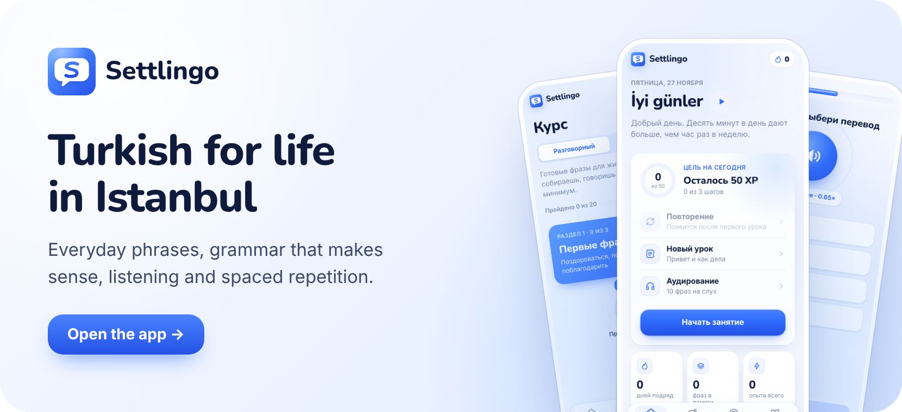
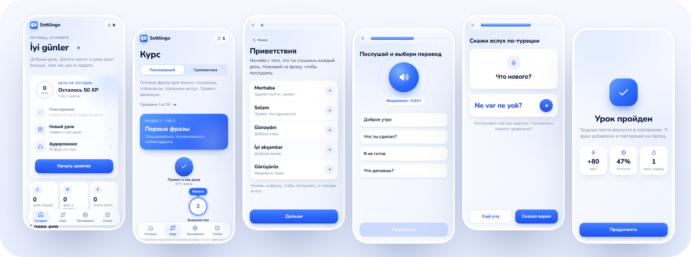
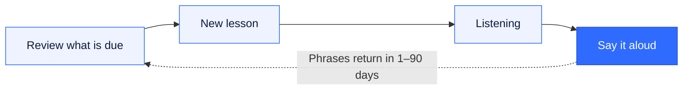

<p align="center">
  <a href="https://anton-babaskin.github.io/Settlingo/"></a>
</p>

<p align="center">
  <a href="README.md"></a>
  <a href="README.uk.md"></a>
  <a href="README.ru.md"></a>
</p>

<p align="center">
  <a href="https://anton-babaskin.github.io/Settlingo/"></a>
  <a href="https://anton-babaskin.github.io/Settlingo/docs/design-review/"></a>
  <br>
  
  
  
  
</p>

**Settlingo** helps people who already live in Istanbul start *speaking* Turkish. You hear the language every day; Settlingo gives you the words, the confidence and a daily habit. Ten minutes a day, right in the browser, free and without sign-up.

> The interface is in Russian for now. Ukrainian and English interfaces and an English course are on the roadmap.

<p align="center"></p>

## What’s inside

<table>
<tr><td width="50%" valign="top"><br><b>Two tracks</b><br>Conversation: 20 lessons of ready-made phrases for real life. Grammar: 14 lessons on how Turkish words are built.</td><td width="50%" valign="top"><br><b>Spaced repetition</b><br>Every learned phrase comes back after 1, 3, 7, 16, 35 and 90 days. A mistake brings it back tomorrow.</td></tr><tr><td width="50%" valign="top"><br><b>Listening</b><br>About 4,000 recorded phrases and word forms, slow playback and dictation.</td><td width="50%" valign="top"><br><b>Say it aloud</b><br>You see a Russian phrase, say it in Turkish, then compare with the recording.</td></tr><tr><td width="50%" valign="top"><br><b>Grammar engine</b><br>Exercises are generated fresh each time and every suffix is explained: vowel harmony, consonant changes, tenses.</td><td width="50%" valign="top"><br><b>403 words</b><br>Basics, daily life in Istanbul (rent, bank, doctor, transport) and live speech.</td></tr>
</table>

## How a day looks



## Courses

| Course | For speakers of | Status | Contents |
|---|---|---|---|
| **Turkish** | Russian |  | 34 lessons · 403 words · audio |
| **English** | Russian, Ukrainian |  | next big step, see roadmap |

## Roadmap

| Stage | What |
|---|---|
| 1. **Foundation** | offline mode, interface in 3 languages, tests, course packs |
| 2. **English course** | English for Russian and Ukrainian speakers |
| 3. **Better learning** | placement test, pronunciation check, dialogues |
| 4. **Sync and sharing** | progress on all devices, share with friends |
| 5. **Mobile apps** | App Store and Google Play |

[Full plan with details →](ROADMAP.md)

## Run locally

It is a static site with no build step. Any static server will do:

```bash
git clone https://github.com/Anton-Babaskin/Settlingo.git
cd Settlingo
python3 -m http.server 8000
# http://localhost:8000
```

Opening `index.html` directly from disk will not play audio: browsers block it on `file://`.

<details>
<summary><b>Project structure</b></summary>

| | |
|---|---|
| `index.html` | Page shell and tab bar |
| `app.css` | Design tokens, components, animations |
| `app.js` | State, spaced repetition, lesson player, screens |
| `data.js` | Course content and vocabulary |
| `morph.js` | Turkish morphology and exercise generator |
| `audio.js · audio/` | Audio packs and playback |
| `brand/ · fonts/` | Logo, icons, Nunito |
| `docs/design-review/` | Design audit, before and after |
| `tools/` | Scripts that build the audio and the logo |

</details>

## Credits

Voice: [Piper](https://github.com/rhasspy/piper) `tr_TR-dfki-medium`, trained on [dfki-ot-data](https://github.com/marytts/dfki-ot-data/) under [CC BY-NC-SA 4.0](https://creativecommons.org/licenses/by-nc-sa/4.0/): the recordings may be used only non-commercially, with attribution and under the same terms. Font: Nunito, [SIL Open Font License 1.1](https://openfontlicense.org).

<p align="center"><br><br><sub>Made in Istanbul</sub></p>
