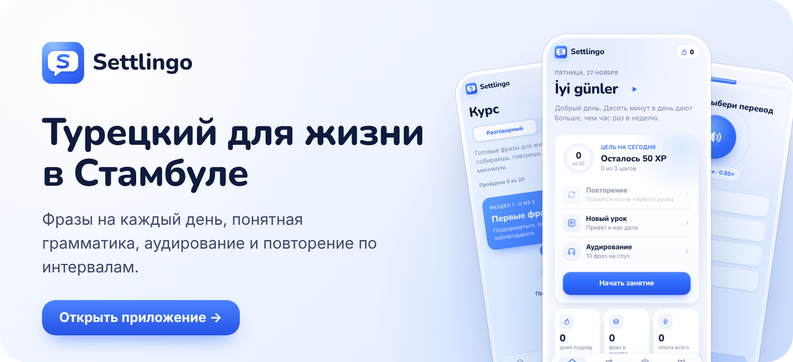
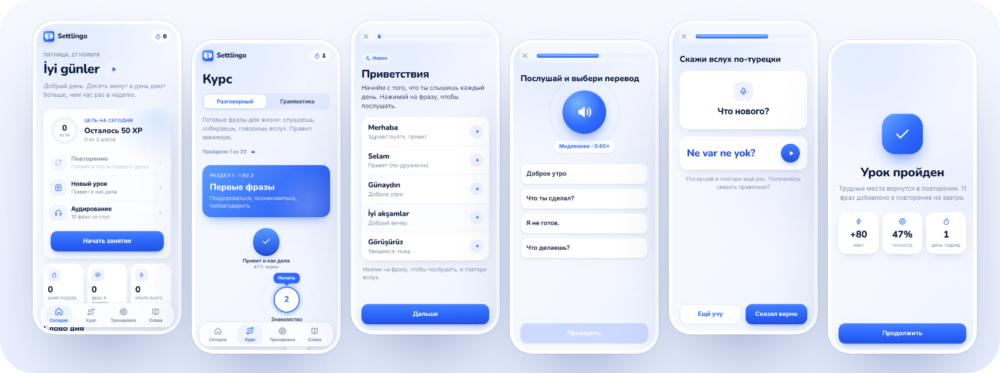
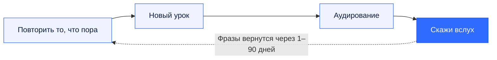

<p align="center">
  
</p>

<p align="center">
  <a href="README.md"></a>
  <a href="README.uk.md"></a>
  <a href="README.ru.md"></a>
</p>

<p align="center">
  
  <a href="docs/design-review/"></a>
  <br>
  
  
  
  <a href="LICENSE"></a>
  <a href="LICENSE-CONTENT.md"></a>
  
</p>

**Blably** — бесплатное приложение для изучения языков в обе стороны: турецкий для русско- и украиноязычных, русский и украинский для турков, позже английский ↔ русский. Для тех, кто живёт рядом с языком и хочет начать на нём *говорить*: слова, уверенность и ежедневная привычка. Десять минут в день, прямо в браузере, без регистрации.

> Сейчас работает турецкий для русскоязычных. Интерфейс переводится на русский, украинский и английский, остальные курсы — по плану.

<p align="center"></p>

## Что внутри

<table>
<tr><td width="50%" valign="top"><br><b>Два трека</b><br>Разговорный: 20 уроков готовых фраз для жизни. Грамматика: 14 уроков о том, как устроены турецкие слова.</td><td width="50%" valign="top"><br><b>Повторение по интервалам</b><br>Каждая выученная фраза возвращается через 1, 3, 7, 16, 35 и 90 дней. Ошибка возвращает её на завтра.</td></tr><tr><td width="50%" valign="top"><br><b>Аудирование</b><br>Около 4 000 записанных фраз и форм слов, медленное воспроизведение и диктант.</td><td width="50%" valign="top"><br><b>Скажи вслух</b><br>Видишь русскую фразу, говоришь её по-турецки и сверяешься с записью.</td></tr><tr><td width="50%" valign="top"><br><b>Грамматический движок</b><br>Задания собираются заново каждый раз, каждый суффикс объяснён: гармония гласных, чередования, времена.</td><td width="50%" valign="top"><br><b>403 слова</b><br>Основа, быт в Стамбуле (аренда, банк, врач, транспорт) и живая речь.</td></tr>
</table>

## Как выглядит день



## Курсы

| Курс | Для тех, кто говорит на | Статус | Что внутри |
|---|---|---|---|
| **Турецкий** | русский |  | 34 урока · 403 слова · озвучка |
| **Турецкий** | украинский |  | те же уроки с объяснениями на украинском |
| **Русский** | турецкий |  | кириллица, фразы на каждый день, падежи через турецкие |
| **Украинский** | турецкий |  | кириллица, фразы на каждый день, грамматика через турецкий |
| **Английский** | русский |  | A1–A2, работа, переезд, путешествия |
| **Русский** | английский |  | на основе курса для турков |

## План развития

| Этап | Что |
|---|---|
| 1. **Фундамент** | интерфейс на русском, украинском и английском, курсы в обе стороны, офлайн, тесты |
| 2. **Турецкий для украинцев** | курс турецкого с объяснениями на украинском |
| 3. **Русский для турков** | кириллица, фразы и грамматика, турецкий интерфейс |
| 4. **Украинский для турков** | то же для украинского |
| 5. **Английский ↔ русский** | последним из курсов |
| 6. **Качество обучения** | тест уровня, проверка произношения, диалоги |
| 7. **Синхронизация** | прогресс на всех устройствах, языковой тандем с друзьями |
| 8. **Мобильные приложения** | App Store и Google Play |

[Подробный план →](ROADMAP.md)

## Запуск у себя

Это статический сайт без сборки. Подойдёт любой статический сервер:

```bash
git clone https://github.com/Anton-Babaskin/Settlingo.git
cd Settlingo
python3 -m http.server 8000
# http://localhost:8000
```

Если открыть `index.html` прямо с диска, страница будет пустой: браузер не загружает модули JavaScript с `file://`.

<details>
<summary><b>Структура проекта</b></summary>

| | |
|---|---|
| `index.html` | Каркас страницы и нижняя панель |
| `app.css` | Дизайн-токены, компоненты, анимации |
| `core/` | Правила без страницы: прогресс, повторение, турецкая морфология, занятия, проверка ответов |
| `ui/` | Экраны, плеер уроков, звук, хранение |
| `i18n/` | Тексты интерфейса на русском, украинском и английском |
| `data.js` | Содержание курса и словарь |
| `audio/ · audio-index.js` | Аудио-пакеты и их указатель |
| `tests/` | Тесты: node --test |
| `brand/ · fonts/` | Логотип, иконки, Nunito |
| `docs/design-review/` | Аудит дизайна, было и стало |
| `tools/` | Скрипты сборки звука и логотипа |

</details>

## Лицензия

Код: [AGPL-3.0-or-later](LICENSE). Уроки, словарь и звук: [CC BY-NC-SA 4.0](https://creativecommons.org/licenses/by-nc-sa/4.0/), только некоммерческое использование с указанием источника. Турецкий голос: [Piper](https://github.com/rhasspy/piper) `tr_TR-dfki-medium`, обучен на [dfki-ot-data](https://github.com/marytts/dfki-ot-data/). Шрифт: Nunito, SIL OFL 1.1. Подробно: [LICENSE-CONTENT.md](LICENSE-CONTENT.md).

<p align="center"><br><br><sub>Сделано в Стамбуле</sub></p>
