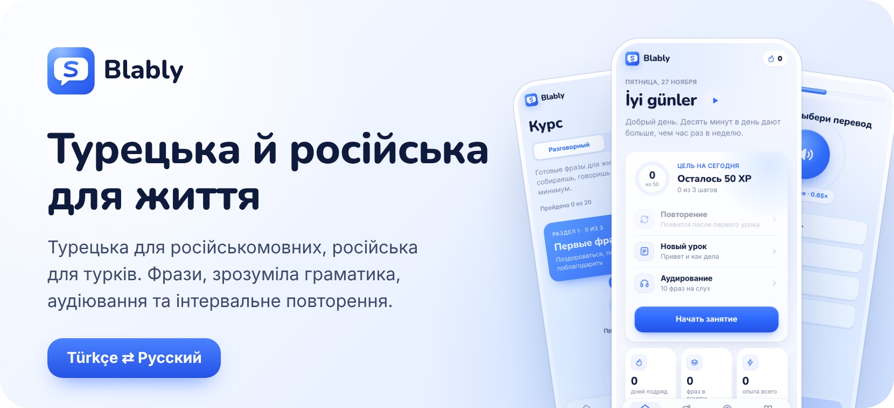
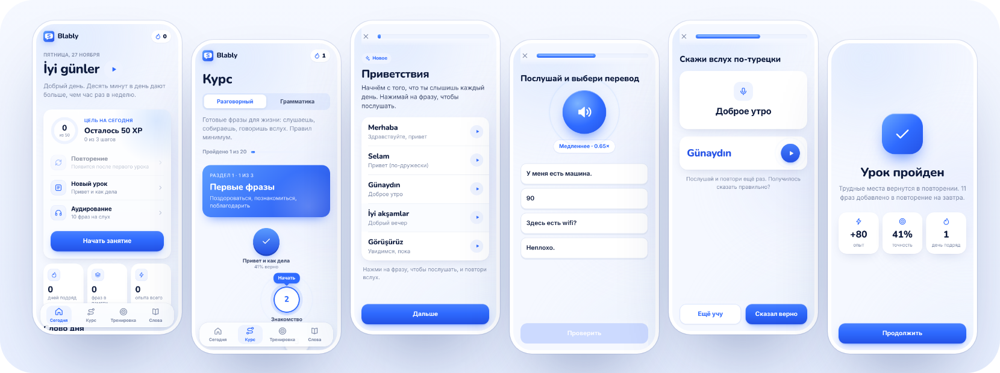
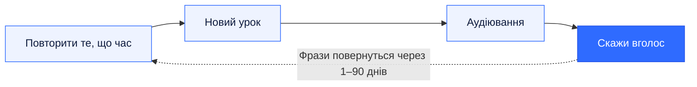

<p align="center">
  
</p>

<p align="center">
  <a href="README.md"></a>
  <a href="README.uk.md"></a>
  <a href="README.ru.md"></a>
</p>

<p align="center">
  
  <a href="docs/design-review/"></a>
  <br>
  
  
  
  <a href="LICENSE"></a>
  <a href="LICENSE-CONTENT.md"></a>
  
</p>

**Blably** — безкоштовний застосунок для вивчення мов в обидва боки: **турецька для російськомовних** і **російська для турків**. Для тих, хто живе поруч із мовою і хоче почати нею *говорити*: слова, впевненість і щоденна звичка. Десять хвилин на день, просто в браузері, без реєстрації.

> Зараз працює турецька для російськомовних, інтерфейс російською. Російська для турків, курс англійської та інтерфейс українською, англійською й турецькою — у планах.

<p align="center"></p>

## Що всередині

<table>
<tr><td width="50%" valign="top"><br><b>Два треки</b><br>Розмовний: 20 уроків готових фраз для життя. Граматика: 14 уроків про те, як побудовані турецькі слова.</td><td width="50%" valign="top"><br><b>Інтервальне повторення</b><br>Кожна вивчена фраза повертається через 1, 3, 7, 16, 35 і 90 днів. Помилка повертає її на завтра.</td></tr><tr><td width="50%" valign="top"><br><b>Аудіювання</b><br>Близько 4 000 записаних фраз і форм слів, повільне відтворення та диктант.</td><td width="50%" valign="top"><br><b>Скажи вголос</b><br>Бачиш фразу російською, кажеш її турецькою і звіряєшся із записом.</td></tr><tr><td width="50%" valign="top"><br><b>Граматичний рушій</b><br>Завдання щоразу генеруються наново, кожен суфікс пояснено: гармонія голосних, чергування, часи.</td><td width="50%" valign="top"><br><b>403 слова</b><br>Основа, побут у Стамбулі (оренда, банк, лікар, транспорт) і жива мова.</td></tr>
</table>

## Як виглядає день



## Курси

| Курс | Для тих, хто говорить | Статус | Що всередині |
|---|---|---|---|
| **Турецька** | російська |  | 34 уроки · 403 слова · озвучення |
| **Російська** | турецька |  | кирилиця, фрази на кожен день, відмінки через турецькі |
| **Англійська** | російська, українська |  | A1–A2, робота, переїзд, подорожі |

## План розвитку

| Етап | Що |
|---|---|
| 1. **Фундамент** | офлайн-режим, інтерфейс чотирма мовами, тести, курси в обидва боки |
| 2. **Курс англійської** | англійська для російсько- та україномовних |
| 3. **Російська для турків** | кирилиця, фрази й граматика з турецьким інтерфейсом |
| 4. **Якість навчання** | тест рівня, перевірка вимови, діалоги |
| 5. **Синхронізація** | прогрес на всіх пристроях, ділитися з друзями |
| 6. **Мобільні застосунки** | App Store і Google Play |

[Детальний план →](ROADMAP.md)

## Запуск локально

Це статичний сайт без збірки. Підійде будь-який статичний сервер:

```bash
git clone https://github.com/Anton-Babaskin/Settlingo.git
cd Settlingo
python3 -m http.server 8000
# http://localhost:8000
```

Якщо відкрити `index.html` просто з диска, звук не запрацює: браузер блокує його на `file://`.

<details>
<summary><b>Структура проєкту</b></summary>

| | |
|---|---|
| `index.html` | Каркас сторінки та нижня панель |
| `app.css` | Дизайн-токени, компоненти, анімації |
| `app.js` | Стан, інтервальне повторення, плеєр уроків, екрани |
| `data.js` | Зміст курсу та словник |
| `morph.js` | Турецька морфологія та генератор завдань |
| `audio.js · audio/` | Аудіопакети та відтворення |
| `brand/ · fonts/` | Логотип, іконки, Nunito |
| `docs/design-review/` | Аудит дизайну, було і стало |
| `tools/` | Скрипти збірки звуку та логотипа |

</details>

## Ліцензія

Код: [AGPL-3.0-or-later](LICENSE). Уроки, словник і звук: [CC BY-NC-SA 4.0](https://creativecommons.org/licenses/by-nc-sa/4.0/), лише некомерційне використання із зазначенням джерела. Турецький голос: [Piper](https://github.com/rhasspy/piper) `tr_TR-dfki-medium`, навчений на [dfki-ot-data](https://github.com/marytts/dfki-ot-data/). Шрифт: Nunito, SIL OFL 1.1. Детально: [LICENSE-CONTENT.md](LICENSE-CONTENT.md).

<p align="center"><br><br><sub>Зроблено в Стамбулі</sub></p>
